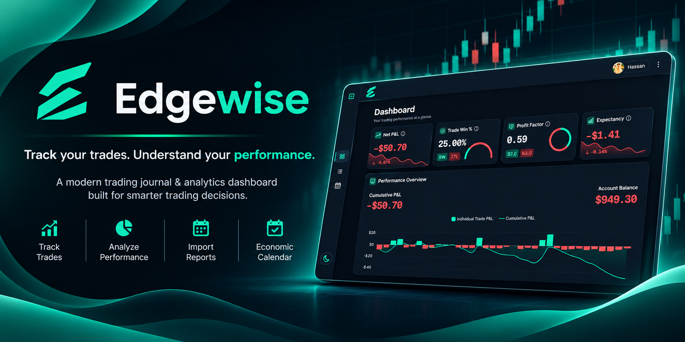

<div align="center">
  
</div> 
<div align="center">

# 📊 Edgewise

### Trading Journal & Analytics Dashboard

A modern and responsive trading journal built with React to help traders record their trading activity, import historical MetaTrader reports, and analyze their performance through statistical metrics and interactive visualizations.

<br />

[](https://edgewise-eight.vercel.app/)
[](https://github.com/Hassan-src/Edgewise)

</div>

---

## ✨ Overview

**Edgewise** is a trading journal and analytics dashboard designed to provide traders with a centralized workspace for managing their trading activity and evaluating their performance.

The application allows users to create a trading account, manually record trades, import historical trading data from MetaTrader reports, and review their results through an analytics dashboard.

Edgewise provides an overview of important trading metrics, including:

- Net profit and loss
- Trading expectancy
- Profit factor
- Win rate
- Individual trade performance
- Cumulative trading performance
- Recent trading activity

The project focuses on combining React component architecture, server-state management, database integration, data visualization, authentication, and responsive interface design into a complete application.

---

## 🛠️ Tech Stack

<div align="center">

### Frontend


### Backend & Data


### Tooling


</div>

### Technologies

| Technology              | Purpose                                               |
| ----------------------- | ----------------------------------------------------- |
| ⚛️ React 19             | UI development and component architecture             |
| 🟨 JavaScript           | Application logic                                     |
| ⚡ Vite                 | Development server and production build               |
| 🎨 Styled Components    | Component-based styling and responsive layouts        |
| 🗄️ Supabase             | Authentication, PostgreSQL database, and file storage |
| 🔄 TanStack React Query | Server-state management, caching, and mutations       |
| 🧭 React Router         | Client-side routing and protected routes              |
| 📊 Recharts             | Trading performance charts and visualizations         |
| 📝 React Hook Form      | Form handling and validation                          |
| 📄 Read Excel File      | Reading and parsing imported Excel reports            |
| 📅 Date-fns             | Date utilities and formatting                         |
| 🎯 React Icons          | Application icons                                     |
| 🔔 React Hot Toast      | Application notifications                             |
| 🔍 ESLint               | Code quality and linting                              |

---

## 🚀 Features

### 📊 Dashboard

A centralized overview of trading performance with automatically calculated statistics.

- **Net P&L:** Displays the total trading profit or loss after trading costs.
- **Expectancy:** Calculates the average expected profit or loss per trade based on historical results.
- **Profit Factor:** Shows the relationship between gross profits and gross losses.
- **Win Rate:** Displays the percentage of profitable trades.
- **Performance Overview:** Visualizes individual trade results alongside cumulative trading performance.
- **Recent Trades:** Displays the five most recent trades.
- **Trading Account Details:** Provides an overview of the associated trading account.

### 📈 Trade Management

Manage trading activity through a dedicated trades page.

- Add trades manually.
- Edit existing trades.
- Delete individual trades.
- View trading history in a structured table.
- Filter trades by their source: manual or imported.
- Filter trades by direction: buy or sell.
- Filter trades by trading symbol.
- Sort trades by profit or loss.
- Navigate through trading records using pagination.
- View trade information, including:
  - Opening and closing date and time
  - Trading symbol
  - Trade direction
  - Volume
  - Opening and closing prices
  - Stop loss
  - Take profit
  - Commission
  - Swap
  - Net profit or loss

### 📥 MetaTrader Report Import

Import historical trading data from MetaTrader reports instead of entering every trade manually.

- Import `.xlsx` spreadsheets containing MetaTrader trading history.
- Parse trade information from uploaded files.
- Extract position IDs, symbols, direction, volume, entry and exit prices, stop loss, take profit, commission, swap, and profit.
- Associate imported trades with the trading account.
- Distinguish imported trades from manually created trades.
- Delete imported trades separately from manually recorded trades.

**Import workflow:**

1. Open the History section in your MetaTrader account.
2. Right-click inside the history tab.
3. Hover over the report section and select the XML report option.
4. Open the exported report in Excel.
5. Save a copy in `.xlsx` format.
6. Upload the spreadsheet through Edgewise.

### 💼 Trading Accounts

Create and manage the trading account used to organize trade records.

- Create a trading account.
- Set an account or strategy name.
- Define the initial account balance.
- Use USD as the account currency.
- Associate manually created and imported trades with the trading account.

### 🌐 Economic Calendar

View economic events through an integrated economic calendar.

- Retrieve daily economic events from an external calendar API.
- Display high-, medium-, and low-impact events.
- View event details, including previous, forecast, and actual values when provided by the API.
- Display scheduled event times.
- Automatically refresh calendar data periodically.

The application retrieves calendar information from the ShowMyTrades public calendar API.

### 🔐 Authentication & Account Management

User authentication and profile management powered by Supabase.

- User registration.
- Email verification.
- User login and logout.
- Protected application routes.
- Persistent authentication sessions.
- Update username.
- Change password.
- Upload and update profile avatars.

### 🎨 User Interface

- Responsive layouts for desktop, tablet, and mobile screens.
- Light and dark themes.
- Reusable component-based interface.
- Consistent styling through a custom design system.
- Responsive tables and forms.
- Loading states and error handling.
- Toast notifications for application feedback.

---

## 🏗️ Application Architecture

Edgewise follows a feature-based React architecture that separates application functionality into dedicated modules.

The main responsibilities are divided between:

- **Pages:** Define the application's main routes.
- **Features:** Group components, forms, and custom hooks by functionality.
- **UI:** Contains reusable interface components.
- **Services:** Handle Supabase authentication and database operations.
- **Context:** Manages application-wide UI preferences.
- **Hooks:** Contains reusable React hooks.
- **Utils:** Contains shared helper functions and data-processing logic.
- **Data:** Handles external economic calendar data retrieval.

### Data Flow

The application uses TanStack React Query to manage server state and communicate with Supabase.

```text
                 Supabase
                     |
                     v
              Service Layer
                     |
                     v
             Custom React Hooks
                     |
                     v
             TanStack React Query
                     |
                     v
              React Components
                     |
                     v
                User Interface
```

Economic calendar data follows a separate flow:

```text
       ShowMyTrades Calendar API
                     |
                     v
       src/data/getEconomicData.js
                     |
                     v
       useEconomicData.js
                     |
                     v
          Economic Components
                     |
                     v
                User Interface
```

This structure keeps data-fetching responsibilities separate from UI components and makes the application easier to maintain and extend.

---

## 📊 Data Visualization

The dashboard uses Recharts to visualize trading performance.

The performance chart combines two types of information:

- **Individual Trade P&L:** Displays the profit or loss of each trade using positive and negative bars.
- **Cumulative P&L:** Displays the accumulated trading performance over the trade history.

This provides a visual representation of both individual trade outcomes and overall performance progression.

---

## 📱 Responsive Design

Edgewise is designed to work across different screen sizes.

The interface adapts to:

- 🖥️ Desktop
- 💻 Laptop
- 📱 Mobile
- 📟 Tablet

Responsive layouts are implemented using CSS media queries, flexible layouts, CSS Grid, and reusable styled components.

The application also adapts its navigation, tables, forms, and dashboard components to smaller screens.

---

## ⚡ Loading & Error States

Edgewise provides appropriate application states when data is being retrieved or an operation fails.

### Loading

Loading indicators are displayed while application data is being retrieved.

### Error Handling

Errors are handled through application-level error states and notifications.

### Notifications

React Hot Toast provides feedback for operations such as creating, updating, importing, and deleting records.

---

## 📂 Project Structure

```text
Edgewise/
│
├── public/
│   ├── Logo-symbol.svg
│   ├── Logo-vertical-dark.svg
│   ├── Logo-vertical-light.svg
│   ├── LogoSymbolDark.svg
│   ├── LogoSymbolLight.svg
│   ├── TrendLossDark.svg
│   ├── TrendLossLight.svg
│   ├── TrendProfitDark.svg
│   ├── TrendProfitLight.svg
│   ├── default-user.svg
│   ├── emptyghost.svg
│   └── loading.svg
│
├── src/
│   │
│   ├── context/
│   │   ├── AppContext.jsx
│   │   └── useAppMode.js
│   │
│   ├── data/
│   │   └── getEconomicData.js
│   │
│   ├── features/
│   │   │
│   │   ├── Dashboard/
│   │   │   ├── ChartToolTip.jsx
│   │   │   ├── DashboardLayout.jsx
│   │   │   ├── Expectancy.jsx
│   │   │   ├── NetTotal.jsx
│   │   │   ├── PerformanceAccountDetails.jsx
│   │   │   ├── PerformanceChart.jsx
│   │   │   ├── PerformanceOverview.jsx
│   │   │   ├── ProfitFactor.jsx
│   │   │   ├── RecentTrades.jsx
│   │   │   ├── RecentTradesTable.jsx
│   │   │   ├── TradeWinRatio.jsx
│   │   │   ├── TradesPerformance.jsx
│   │   │   ├── useAllTrades.js
│   │   │   └── useRecentTrades.js
│   │   │
│   │   ├── Economic/
│   │   │   ├── EconomicRow.jsx
│   │   │   ├── EconomicTable.jsx
│   │   │   └── useEconomicData.js
│   │   │
│   │   ├── Trades/
│   │   │   ├── AddTrade.jsx
│   │   │   ├── CreateTradeAccount.jsx
│   │   │   ├── CreateTradeForm.jsx
│   │   │   ├── DeleteImportedDataShow.jsx
│   │   │   ├── ImportTrade.jsx
│   │   │   ├── ImportTradesForm.jsx
│   │   │   ├── TradeAccountForm.jsx
│   │   │   ├── TradesRow.jsx
│   │   │   ├── TradesTable.jsx
│   │   │   ├── TradesTableOperations.jsx
│   │   │   ├── parseImportedData.js
│   │   │   ├── useAccount.js
│   │   │   ├── useAddTrade.js
│   │   │   ├── useCreateAccount.js
│   │   │   ├── useDeleteImportedTrades.js
│   │   │   ├── useDeleteTrade.js
│   │   │   ├── useImportTrade.js
│   │   │   ├── useTrades.js
│   │   │   ├── useTradesSymbols.js
│   │   │   └── useUpdateTrade.js
│   │   │
│   │   └── authentication/
│   │       ├── LoginForm.jsx
│   │       ├── SignupForm.jsx
│   │       ├── UpdateUserDataForm.jsx
│   │       ├── UpdateUserPasswordForm.jsx
│   │       ├── UserAvatar.jsx
│   │       ├── useLogin.js
│   │       ├── useLogout.js
│   │       ├── useSignup.js
│   │       ├── useUpdateUser.js
│   │       └── useUser.js
│   │
│   ├── hooks/
│   │   ├── useClickOutside.js
│   │   └── useLocalStorageState.js
│   │
│   ├── pages/
│   │   ├── Account.jsx
│   │   ├── Dashboard.jsx
│   │   ├── EconomicEvents.jsx
│   │   ├── Login.jsx
│   │   ├── PageNotFound.jsx
│   │   ├── Signup.jsx
│   │   ├── Trades.jsx
│   │   └── VerifyEmail.jsx
│   │
│   ├── services/
│   │   ├── apiAuth.js
│   │   ├── apiTrades.js
│   │   ├── apiTradesAccount.js
│   │   └── supabase.js
│   │
│   ├── styles/
│   │   └── GlobalStyles.js
│   │
│   ├── ui/
│   │   ├── AppLayout.jsx
│   │   ├── Avatar.jsx
│   │   ├── ButtonIcon.jsx
│   │   ├── Buttons.jsx
│   │   ├── Card.jsx
│   │   ├── CardChart.jsx
│   │   ├── CardFooter.jsx
│   │   ├── CardHead.jsx
│   │   ├── CardHelperInfo.jsx
│   │   ├── CardInfo.jsx
│   │   ├── ConfirmDelete.jsx
│   │   ├── DarkModeToggle.jsx
│   │   ├── EmptyDashboard.jsx
│   │   ├── ErrorFallBack.jsx
│   │   ├── FileInput.jsx
│   │   ├── Filter.jsx
│   │   ├── Form.jsx
│   │   ├── FormRow.jsx
│   │   ├── FormRowVertical.jsx
│   │   ├── Header.jsx
│   │   ├── Heading.jsx
│   │   ├── ImageInput.jsx
│   │   ├── Input.jsx
│   │   ├── InputPassword.jsx
│   │   ├── Loading.jsx
│   │   ├── Logo.jsx
│   │   ├── MainNav.jsx
│   │   ├── Menus.jsx
│   │   ├── MetricValue.jsx
│   │   ├── Modal.jsx
│   │   ├── NoAccount.jsx
│   │   ├── Pagination.jsx
│   │   ├── ProtectedRoute.jsx
│   │   ├── Row.jsx
│   │   ├── SecondaryText.jsx
│   │   ├── Select.jsx
│   │   ├── SideBar.jsx
│   │   ├── SmallNav.jsx
│   │   ├── SortBy.jsx
│   │   ├── SpinnerMini.jsx
│   │   ├── Table.jsx
│   │   ├── TableOperations.jsx
│   │   ├── TextArea.jsx
│   │   ├── TextLink.jsx
│   │   ├── TrendLine.jsx
│   │   └── Warning.jsx
│   │
│   ├── utils/
│   │   ├── constants.js
│   │   ├── fileHeaderChecker.js
│   │   ├── getTradePerformance.js
│   │   ├── helper.js
│   │   └── readExcel.js
│   │
│   ├── App.jsx
│   └── main.jsx
│
├── .gitignore
├── eslint.config.js
├── index.html
├── package-lock.json
├── package.json
└── vite.config.js
```

---

## 📦 Getting Started

### Prerequisites

Before running Edgewise locally, make sure you have:

- [Node.js](https://nodejs.org/)
- npm
- A [Supabase](https://supabase.com/) project

### 1. Clone the repository

```bash
git clone https://github.com/Hassan-src/Edgewise.git
```

### 2. Navigate to the project directory

```bash
cd Edgewise
```

### 3. Install dependencies

```bash
npm install
```

### 4. Configure Supabase

Edgewise uses Supabase for authentication, database operations, and avatar storage.

The Supabase client is configured in:

```text
src/services/supabase.js
```

To run your own instance, replace the existing Supabase project URL and publishable key with your own project credentials.

The application uses the following Supabase resources:

- **Authentication:** User registration, email verification, login, and session management.
- **`trades` table:** Stores manually created and imported trades.
- **`trading_accounts` table:** Stores trading account information.
- **`avatars` storage bucket:** Stores user profile avatars.

Configure the corresponding database tables, authentication settings, storage bucket, and Row Level Security (RLS) policies in your Supabase project.

**Note:** Database schema and migration files are not included in this repository.

### 5. Start the development server

```bash
npm run dev
```

Vite starts the development server. Open the local URL displayed in your terminal.

---

## 📜 Available Scripts

| Command           | Description                           |
| ----------------- | ------------------------------------- |
| `npm run dev`     | Starts the Vite development server    |
| `npm run build`   | Builds the application for production |
| `npm run preview` | Previews the production build locally |
| `npm run lint`    | Runs ESLint                           |

---

## 📚 What I Learned

Building Edgewise strengthened my understanding of:

- ⚛️ React component architecture
- 🧩 Feature-based project organization
- 🪝 Custom React Hooks
- 🧠 Context API
- 🔄 TanStack React Query
- 🗄️ Supabase integration
- 🔐 User authentication and protected routes
- 📝 Form handling and validation
- 📥 Excel file parsing and data processing
- 📊 Data visualization with Recharts
- 🌐 External API integration
- ⚡ Asynchronous JavaScript
- 📱 Responsive layouts
- 🎨 Styled Components and reusable design systems
- 🔄 Server-state caching and mutations
- ⏳ Loading and error states
- 🧭 Client-side routing
- 🔍 ESLint and code quality
- 🚀 Production deployment with Vercel

---

## 🎯 Project Goals

Edgewise was built as a practical full-featured React application to move beyond isolated frontend exercises and work with a real-world application involving authentication, persistent data, file processing, and analytics.

The main development goals were to apply these concepts together:

```text
React
  |
  v
Component Architecture
  |
  v
State Management
  |
  v
Supabase Integration
  |
  v
Authentication & Database
  |
  v
Data Processing
  |
  v
Analytics & Visualization
  |
  v
Responsive User Interface
  |
  v
Production Deployment
```

The application focuses on building a maintainable frontend architecture while integrating backend services and real trading data.

---

## 🚀 Deployment

Edgewise is deployed using Vercel.

### Live Application

https://edgewise-eight.vercel.app/

### GitHub Repository

https://github.com/Hassan-src/Edgewise

---

## 🤝 Contributing

Suggestions, bug reports, and improvements are welcome.

### 1. Fork the repository

```bash
git clone https://github.com/Hassan-src/Edgewise.git
```

### 2. Create a feature branch

```bash
git checkout -b feature/your-feature
```

### 3. Commit your changes

```bash
git add .
git commit -m "Add your feature"
```

### 4. Push your branch

```bash
git push origin feature/your-feature
```

Then open a Pull Request.

---

## 🐛 Issues & Suggestions

If you find a bug or have a suggestion for improving Edgewise, feel free to open an issue on GitHub.

**GitHub Repository:**

https://github.com/Hassan-src/Edgewise

---

## 🌐 Links

### 🚀 Live Demo

https://edgewise-eight.vercel.app/

### 💻 Source Code

https://github.com/Hassan-src/Edgewise

### 🐙 GitHub

https://github.com/Hassan-src

---

## 👨‍💻 Developer

### Hassan Esmaeilpour

Frontend Developer focused on building clean, interactive, and responsive web applications with React.

---

## ⭐ Support

If you find Edgewise useful, consider giving the repository a ⭐ on GitHub.

---

<div align="center">

### 📊 Edgewise

**Track your trades. Understand your performance.**

Built with React, Supabase, and modern frontend technologies.

</div>
